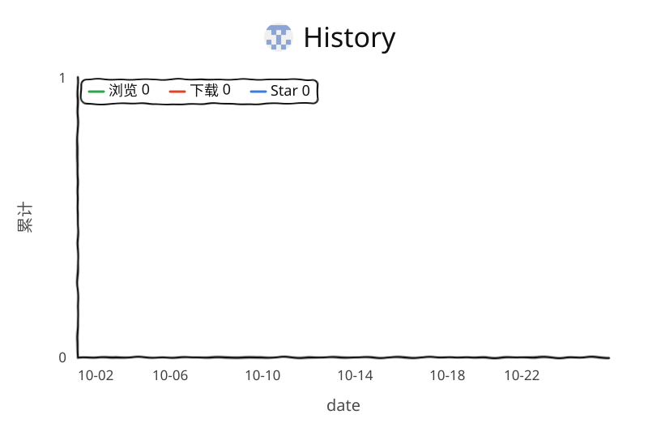

# u2-rss-suite

中文 | [English](#english)

给 U2 做的两个自动追种小工具。它们不做下载，只做一件事：把找到的种子**变成一个 RSS 订阅源**，剩下的交给 Vertex、autobrr 这类工具去处理。

为什么绕这么一圈？因为原来的脚本是往 qBittorrent 的监控目录里丢种子文件，只在本机能用。改成 RSS 之后，跑在哪台机器上都一样，VPS、NAS、容器都行，下游怎么下载、怎么删种、怎么分类，全由 Vertex 统一管。

## 里面有什么

### u2-catchmagic-rss

盯着 U2 的魔法种子，出现就收进来，输出成 RSS。

适合把追魔这件事统一接进 Vertex 的场景。目录：`u2-catchmagic-rss/`

### u2-newtorrents-rss

盯 U2 的新种子，按条件筛一遍，同样输出成 RSS。

不再直接写 qB 监控目录。目录：`u2-newtorrents-rss/`

两个都源自这些项目，做了改造：

- `https://github.com/zS1m/U2-CatchMagic-RSS`
- `https://github.com/Haruite/u2_scripts`

## 它好用的地方

- **只输出 RSS**，不落地种子文件，符合标准 RSS 2.0，下游工具都能吃
- **自带一个很轻的 HTTP 服务**，起来就有 `/rss.xml`
- **筛选逻辑沿用原版**：体积、做种人数、发布时间、魔法关键词都能设条件
- **适合容器化和多设备**，一个订阅地址到处用

## 跑起来

```bash
git clone https://github.com/ccrichard3/u2-rss-CatchMagic-NewTorrents.git
cd u2-rss-CatchMagic-NewTorrents
```

先起追魔：

```bash
cd u2-catchmagic-rss
cp .env.example .env
vim .env
docker compose up -d --build
```

再起新种：

```bash
cd ../u2-newtorrents-rss
cp .env.example .env
vim .env
docker compose up -d --build
```

## 接到 Vertex 上

- 在 Vertex 里加一个 RSS 订阅
- 地址填对应服务的 `/rss.xml`
- 勾上「推送种子文件」
- 下载行为全部交给 Vertex

## 几个需要注意的

- `u2-newtorrents-rss` 第一次运行只建立基线，所以 RSS 一开始可能是空的，这是正常的
- RSS 暂时没有 item 时，Vertex 可能会报异常，一般忽略就行
- 建议在 Vertex 里填上 U2 的 cookie，否则后面拉种可能没权限

## 免责声明

本脚本仅供技术交流与学习使用。请严格遵守 U2 站点的相关使用规定。
作者不对因使用本脚本导致的任何账号违规、封禁等后果承担责任。

---

## English

Adapted from:

- `https://github.com/zS1m/U2-CatchMagic-RSS`
- `https://github.com/Haruite/u2_scripts`

This repository provides U2 automation scripts for Vertex-style integrated management tools.

Instead of appending tasks through a watch-folder workflow, these scripts expose RSS feeds so that downstream download, deletion, and category management can be handled centrally by Vertex.

### Included projects

- `u2-catchmagic-rss`
  - Tracks U2 promotion / magic entries
  - Exposes them as RSS for Vertex / autobrr

- `u2-newtorrents-rss`
  - Tracks U2 new torrents
  - Exposes them as RSS for Vertex-managed download workflows

### Highlights

- RSS-driven workflow
- Built for integration tools such as Vertex
- Lightweight built-in HTTP RSS service
- Keeps the core filtering logic from the original scripts

### Disclaimer

This project is for technical exchange and learning only. Please strictly follow the rules of the U2 site. The author assumes no responsibility for account violations, bans, or other consequences caused by using this project.

## 使用趋势

<picture>
  <source media="(prefers-color-scheme: dark)" srcset="traffic/views-dark.svg" />
  <source media="(prefers-color-scheme: light)" srcset="traffic/views.svg" />
  
</picture>
